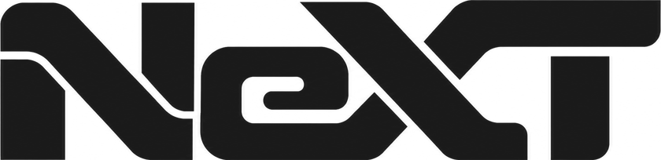

<a href="https://github.com/NV-Davyd/NeXT">
  <picture>
    <source media="(prefers-color-scheme: dark)" srcset="assets/next-wordmark-white.png">
    
  </picture>
</a>

I build mods for CarX Drift Racing Online, with more than 6,500 downloads so far.

| Mod | What it does | Downloads |
| --- | --- | --- |
| [NeXT](https://github.com/NV-Davyd/NeXT) | HUD, player inspection and custom maps for CarX Drift Racing Online 2 |  |
| [NetcodeFix](https://github.com/NV-Davyd/NetcodeFix) | Tighter remote-car sync in tandem rooms |  |
| [NoDynCollisions](https://github.com/NV-Davyd/NoDynCollisions) | Turns off dynamic speed and direction collision resolving |  |
| [SyncStartLights](https://github.com/NV-Davyd/SyncStartLights) | Synced start lights for a chosen lead and chase pair |  |

[Discord](https://discord.gg/Zrqg7GyrB4) · [NeXT account](https://next-mod.pages.dev)
